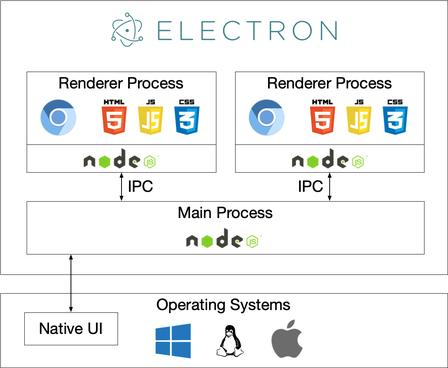

### 什么是 Electron 应用
Electron 是由 GitHub 发起、OpenJS 基金会维护的开源跨平台桌面应用开发框架。**基于 Electron 框架开发的桌面客户端程序，统称为 Electron 应用**。

它的核心本质可以用公式概括：
> **Electron = Chromium 浏览器内核 + Node.js 运行时 + 桌面原生 API**

它把网页渲染能力和本地系统能力封装在一起，开发者只用 HTML/CSS/JavaScript/前端框架（Vue/React 等）写一套代码，就能打包出 Windows、macOS、Linux 三端通用的桌面安装包，无需学习 C++、Swift 等原生桌面开发语言。

---

### 核心运行架构：双进程模型
Electron 采用经典的主进程 + 渲染进程双进程架构，两者通过 IPC（进程间通信）交换数据：

- **主进程（Main Process）**：运行在 Node.js 环境中，是应用的“大脑”。负责窗口管理、应用生命周期、系统托盘、全局快捷键、文件读写、系统调用等底层能力。
- **渲染进程（Renderer Process）**：运行在 Chromium 沙箱中，每个窗口对应一个渲染进程，是应用的“界面层”。负责渲染 UI、处理用户交互，和普通网页运行环境几乎一致。

### 核心架构示意图

---

### 核心特点
#### 优势
1. **跨平台复用**：一套前端代码，同时覆盖 Windows、macOS、Linux 三大桌面系统，大幅降低开发和维护成本。
2. **技术门槛低**：前端开发者可直接上手，复用整个 Web 生态（组件库、npm 包、前端框架），无需重新学习原生桌面技术栈。
3. **能力完整**：同时拥有浏览器的渲染能力和 Node.js 的系统级能力，既能做复杂交互界面，也能直接读写本地文件、调用系统命令、对接本地数据库。
4. **迭代效率高**：功能更新和 Web 产品一样灵活，适合快速迭代、快速验证的产品。

#### 劣势
1. **安装包体积大**：内置完整 Chromium 内核，基础安装包通常 100MB 起步。
2. **内存占用高**：运行时等价于启动一个独立浏览器进程，内存消耗显著高于 C++/Rust 开发的原生应用。
3. **启动速度慢**：需要加载 Chromium 和 Node.js 运行时，冷启动速度比原生桌面程序慢。
4. **性能上限低**：密集计算、高帧率渲染场景的表现弱于原生应用。

---

### 常见的 Electron 应用
你之前使用的 **Obsidian** 就是典型的 Electron 应用，此外主流产品还有：
- 开发工具：VS Code、Postman、GitHub Desktop、微信开发者工具
- 协作办公：Notion、Slack、Discord、飞书桌面端
- 设计创意：Figma 桌面版、Canva 可画
- AI 工具：ChatGPT 桌面版、Claude 桌面版

---

### 适用与不适用场景
✅ **适合场景**：生产力工具、协作软件、内部运维工具、内容创作工具，以及优先考虑开发效率、跨平台覆盖、快速迭代的产品。
❌ **不适合场景**：对性能、体积、启动速度要求极高的专业软件（如大型游戏、工业设计软件）。

需要我补充 Electron 应用的打包方式、常见优化方案，或者和 Tauri 等同类框架的对比吗？